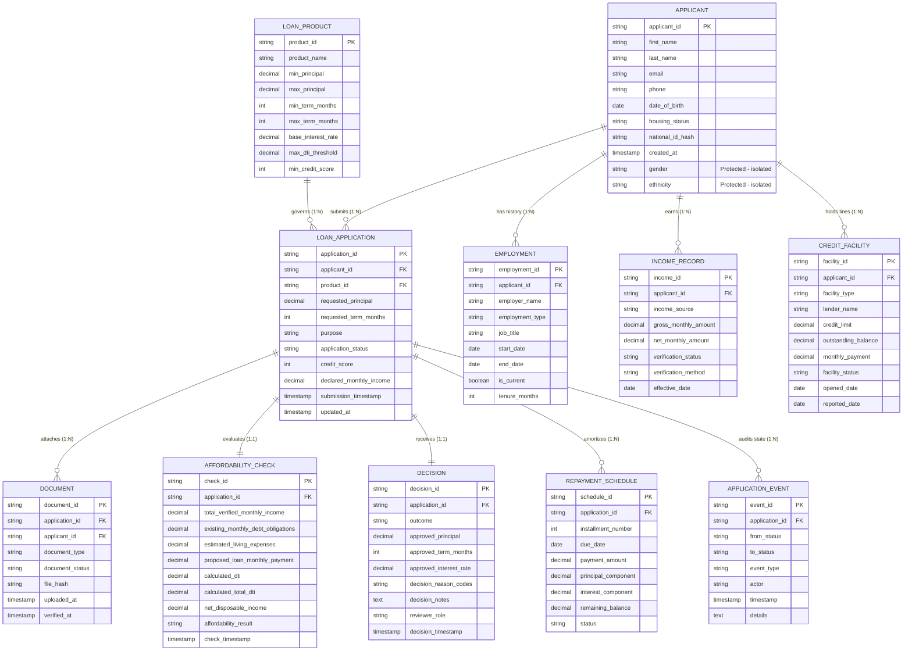
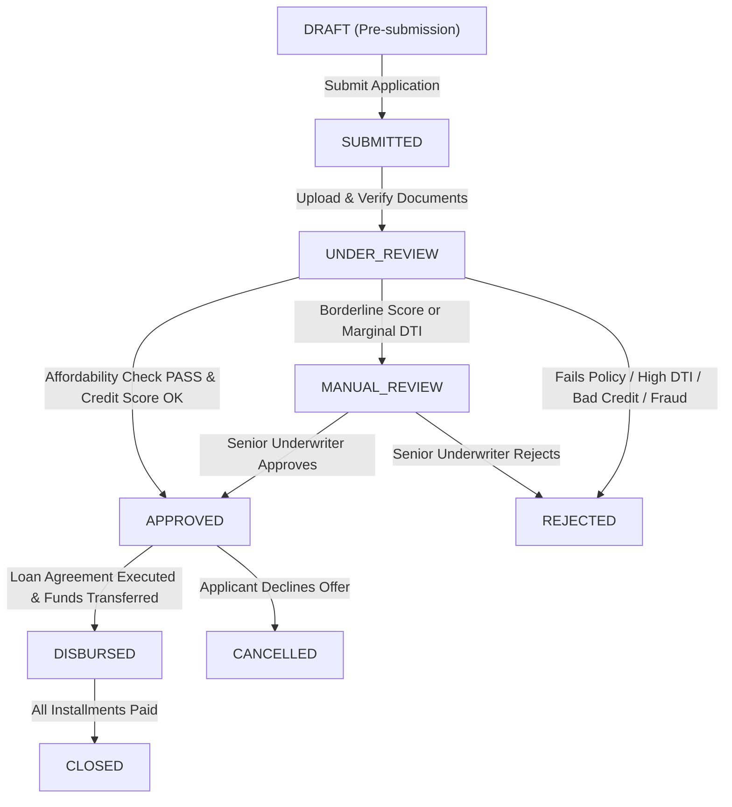

# Entity-Relationship Diagram (ERD) & Architecture

This document describes the relational architecture, cardinalities, lifecycle states, and state transition event model.

---

## 1. Entity-Relationship Model (Mermaid Diagram)

---

## 2. Cardinality & Relationship Matrix

| Parent Entity | Child Entity | Cardinality | Optionality | Description |
| :--- | :--- | :---: | :---: | :--- |
| `Applicant` | `Employment` | **1 : N** | Optional (0..N) | An applicant may have 0 (unemployed) or multiple employments (e.g. current + historical). |
| `Applicant` | `IncomeRecord` | **1 : N** | Mandatory (1..N) | An applicant has 1 or more income streams (salary, secondary, investments). |
| `Applicant` | `CreditFacility` | **1 : N** | Optional (0..N) | An applicant may have 0 to multiple credit lines on bureau file. |
| `Applicant` | `LoanApplication` | **1 : N** | Optional (0..N) | An applicant can submit multiple loan applications over time. |
| `LoanProduct` | `LoanApplication` | **1 : N** | Mandatory (1..N) | Every application references exactly one active loan product. |
| `LoanApplication`| `Document` | **1 : N** | Mandatory (2..N) | An application requires KYC and income documentation attached. |
| `LoanApplication`| `AffordabilityCheck`| **1 : 1** | Mandatory (1..1) | Every application has an evaluated affordability record. |
| `LoanApplication`| `Decision` | **1 : 1** | Mandatory (1..1) | Every application receives an underwriting decision. |
| `LoanApplication`| `RepaymentSchedule` | **1 : N** | Conditional (0..N) | Populated only for `APPROVED` loans (N = approved term months). |
| `LoanApplication`| `ApplicationEvent` | **1 : N** | Mandatory (1..N) | Immutable chronological ledger of all lifecycle events. |

---

## 3. Lifecycle State Machine

The loan origination workflow follows an explicit state transition machine:

### State Transition Rules:
1. **`SUBMITTED` -> `UNDER_REVIEW`**: Initiated once applicant submits requested loan parameters and documents are logged.
2. **`UNDER_REVIEW` -> `APPROVED`**: Triggered when all KYC documents are verified, credit score meets product minimum, DTI is within policy thresholds, and disposable income buffer is positive.
3. **`UNDER_REVIEW` -> `MANUAL_REVIEW`**: Triggered when credit score is borderline (within 20 points), DTI is marginal, or minor document discrepancy requires human review.
4. **`UNDER_REVIEW` -> `REJECTED`**: Triggered when any hard policy check fails (DTI exceeded, severe delinquency, term out of product bounds, unverified identity).
5. **`APPROVED` -> `DISBURSED`**: Triggered upon loan closing; creates amortization schedule and initiates payout event.
